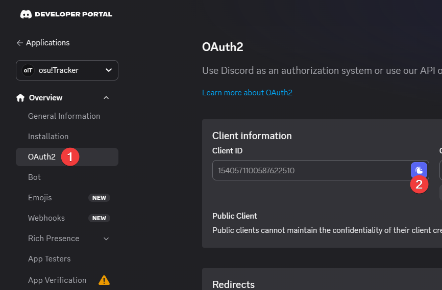
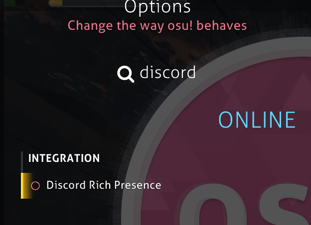
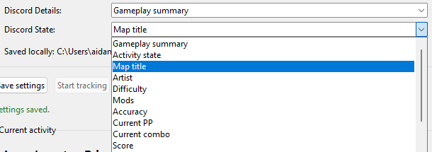

# osu!Tracker

#### **_Better_** _Discord Rich Presence for osu!_


A Windows desktop app that tracks osu! in-game statistics and displays them in
Discord Rich Presence.

## Requirements

- Windows 10 or newer (sorry, no Linux or macOS support right now)
- [Tosu!](https://tosu.app/) installed on your system

## Installation

1. Download `osu-tracker.exe` from the latest [GitHub release](https://github.com/user-attachments/releases) or [build it yourself](#building-a-executable).
2. Start Tosu! and confirm its local API is available (normally
   `http://127.0.0.1:24050/json`).
3. Open `osu-tracker.exe`.
4. Enter your Discord application ID in the app [^1], if you want Discord Rich
   Presence, then select **Save settings** and **Start tracking**.

   > Create a Discord application in the [Discord Developer Portal](https://discord.com/developers/applications)
   > and copy its Client ID from **OAuth2**.
   > 

> **Important:** Turn off Osu!'s in-game Discord Rich Presence before running
> osu!Tracker to prevent conflicting activities.
>
> 

## Use the app

The Discord **Details** and **State** dropdowns can use the gameplay summary, activity
state, map metadata, mods, accuracy, PP, combo, score, player name, star
rating, or BPM. Settings can be changed at any time and apply on the next
start (or after a restart).



## Command line (optional)

The normal command opens the desktop app. For automation and troubleshooting,
the previous command-line interface remains available:

```powershell
osu-tracker-cli --once --no-discord
```

Run `osu-tracker-cli --help` for all CLI options. `--configure` and
`--show-settings` continue to manage the same saved settings file.

## Building a executable

Clone the repository, open PowerShell in the project folder, then run:

```powershell
.\scripts\build-windows.ps1
```

The script installs the project and PyInstaller, then creates the executable at:

```text
dist\osu-tracker.exe
```

To use a specific Python command, pass it explicitly:

```powershell
.\scripts\build-windows.ps1 -Python py
```

## Documentation

See [docs/tosu-data.md](docs/tosu-data.md) for the complete Pydantic model
reference, common field lookups, and examples.
